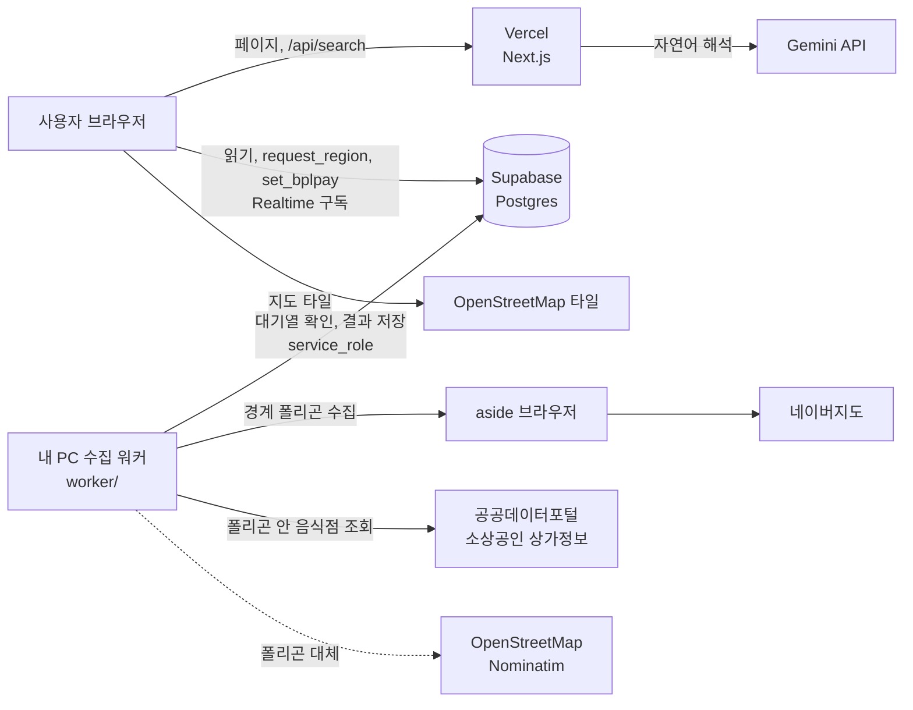
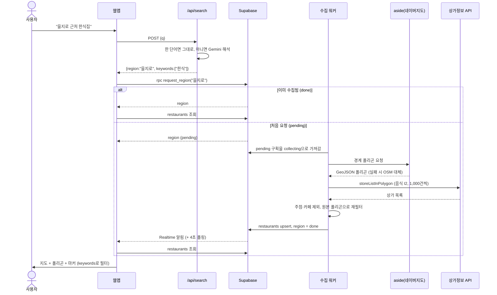
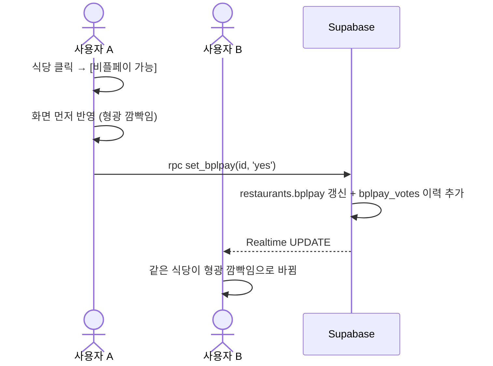
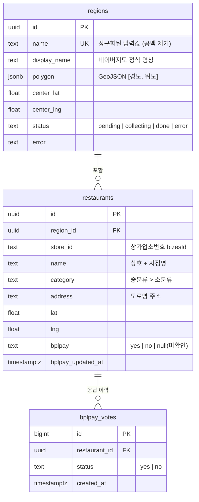

# Architecture

비플페이 지도의 구조를 설명합니다.

## 1. 전체 구성



| 구성 요소 | 실행 위치 | 역할 |
| --- | --- | --- |
| 웹앱 (Next.js) | Vercel | 검색 화면, 지도, 자연어 검색 API |
| Supabase | 클라우드 | 구획·식당·응답 저장, 수집 대기열, 실시간 알림 |
| 수집 워커 | 내 PC | 대기열 처리. aside와 상가정보 API로 데이터 수집 |
| aside | 내 PC | 실제 브라우저로 네이버지도에서 경계 폴리곤 획득 |

**수집 워커가 내 PC에 있는 이유:** 네이버지도는 서버에서 직접 요청하면 캡차로 막힙니다. aside는 내 PC에서만 실행되므로, Vercel이 직접 수집하지 않고 Supabase를 대기열로 써서 내 PC 워커가 처리합니다.

## 2. 주요 흐름

### 2.1 검색과 수집



### 2.2 비플페이 응답



- 판정 규칙: 가장 최근 응답이 `restaurants.bplpay`를 덮어씁니다.
- 저장에 실패하면 A의 화면을 원래대로 되돌립니다.

## 3. 폴더 구조

```
.
├── app/
│   ├── layout.tsx            # 공통 레이아웃, Leaflet CSS
│   ├── globals.css           # 화면 스타일, 마커 상태별 스타일, 깜빡임 애니메이션
│   ├── page.tsx              # 메인 화면: 검색 → 수집 요청 → 지도, 실시간 구독
│   ├── demo/page.tsx         # 키 없이 마커 표시를 확인하는 데모
│   └── api/search/route.ts   # Gemini 자연어 검색 해석 (서버)
├── components/
│   └── MapView.tsx           # Leaflet 지도, 폴리곤, 마커, 팝업 버튼
├── lib/
│   ├── supabase.ts           # 브라우저용 Supabase 클라이언트 (anon 키)
│   └── types.ts              # Region, Restaurant, SearchIntent 타입
├── worker/                   # 내 PC에서만 실행 (Vercel에 배포되지 않음)
│   ├── index.mjs             # 대기열 처리 루프, 저장
│   ├── aside.mjs             # aside CLI 실행, 경계 폴리곤 JSON 파싱
│   ├── stores.mjs            # 상가정보 API 호출, 페이지 넘김, 업종 필터
│   └── debug/                # aside 원본 응답 (git 제외)
├── supabase/
│   └── schema.sql            # 테이블, RLS, RPC 함수, Realtime 설정
├── .env.example              # 환경 변수 목록
├── README.md                 # 기획과 실행 방법
├── 작업절차.md                # 개발 단계별 기록
└── architecture.md           # 이 문서
```

## 4. 데이터 모델



- `restaurants`는 `(region_id, store_id)`가 유일합니다. 재수집할 때 upsert하며 `bplpay`는 건드리지 않아서 사용자 응답이 유지됩니다.

## 5. 보안

| 대상 | 권한 |
| --- | --- |
| 익명 사용자 (anon 키) | 모든 테이블 읽기. 쓰기는 `request_region`, `set_bplpay` 함수로만 가능 |
| 수집 워커 (service_role 키) | 전체 쓰기. 내 PC의 `.env.local`에만 보관하고 Vercel에는 넣지 않음 |
| Gemini 키 | Vercel 서버에만 보관. 브라우저에는 노출되지 않음 |

- 두 함수는 `security definer`로 실행됩니다. 입력값을 검사합니다: 구획 이름 40자 이하, 상태값은 `yes`/`no`만 허용.
- 로그인이 없으므로 누구나 응답을 바꿀 수 있습니다. 장난 응답을 막아야 하면 `bplpay_votes` 이력으로 추적하거나 요청 횟수를 제한하는 방안을 검토합니다.

## 6. 외부 서비스

| 서비스 | 용도 | 키 | 비고 |
| --- | --- | --- | --- |
| OpenStreetMap 타일 | 지도 배경 | 불필요 | 사용 정책상 대량 트래픽이면 타일 서버 교체 검토 |
| Nominatim | 네이버 폴리곤 실패 시 대체 경계 | 불필요 | User-Agent 필수, 초당 1회 제한 |
| 네이버지도 (aside 경유) | 구획 경계 폴리곤 | 불필요 (aside 로그인) | 이용약관 확인 필요 |
| 소상공인 상가(상권)정보 | 식당 목록 | `DATA_GO_KR_KEY` | 무료. 분기 단위로 갱신 |
| Gemini | 자연어 검색 해석 | `GEMINI_API_KEY` | 모델은 `GEMINI_MODEL`로 변경 |
| Supabase | DB, 실시간 알림 | URL, anon, service_role | |

## 7. 환경 변수

| 변수 | 웹앱 (Vercel) | 수집 워커 (내 PC) |
| --- | :---: | :---: |
| `NEXT_PUBLIC_SUPABASE_URL` | ✅ | ✅ |
| `NEXT_PUBLIC_SUPABASE_ANON_KEY` | ✅ | |
| `GEMINI_API_KEY`, `GEMINI_MODEL` | ✅ | |
| `SUPABASE_SERVICE_ROLE_KEY` | ❌ 넣지 않음 | ✅ |
| `DATA_GO_KR_KEY` | | ✅ |
| `ASIDE_BIN`, `ASIDE_TIMEOUT_MS` | | ✅ (선택) |

## 8. 한계와 확장 방향

- 수집 PC가 꺼져 있으면 새 구획은 "수집 대기 중"으로 남습니다. 이미 수집된 구획은 언제든 볼 수 있습니다.
- 상가정보는 분기 단위로 갱신되므로 최근 개업한 가게는 빠질 수 있습니다. 필요하면 구획 재수집 기능을 추가합니다.
- 마커가 수백 개를 넘으면 마커 클러스터링 도입을 검토합니다.
